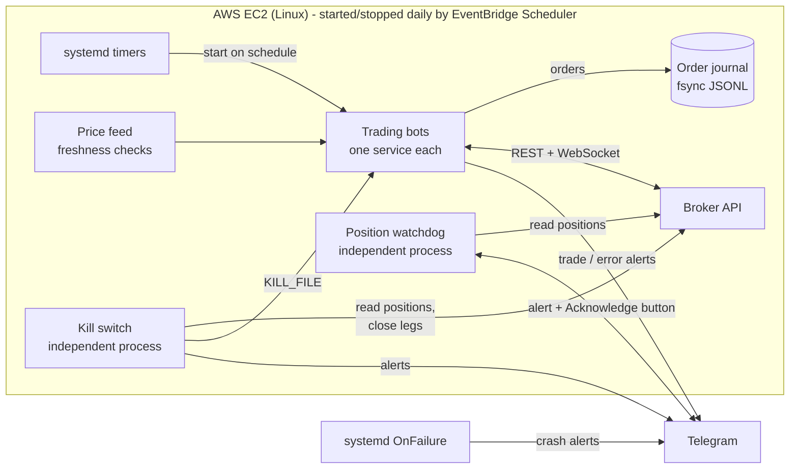

# Trading Automation Showcase

Production patterns from a **live, real-money Python options-trading system** running unattended on AWS for Indian markets (NSE F&O / MCX).

This repo is a curated, sanitized extract: the reliability and risk-control layer of the system, with broker credentials, account details and strategy logic removed. Every module here exists because of a real production failure mode.

## Architecture

## What's inside

| Module | Problem it solves |
|---|---|
| [`src/broker/price_feed.py`](src/broker/price_feed.py) | **Stale WebSocket prices.** A silent socket leaves the last tick in the cache; `cache.get(x) or rest(x)` then never refreshes. Ticks are stored with receive time and only trusted inside a 2.5 s window; otherwise a fresh REST quote is forced. Feed-silence and sidecar-heartbeat checks included. |
| [`src/execution/order_journal.py`](src/execution/order_journal.py) | **Restart amnesia.** Every order is written and fsynced the moment the broker responds, with explicit "may exist" outcomes, so after a crash the bot can reconcile its own orders separately from manual trades. |
| [`src/risk/kill_switch.py`](src/risk/kill_switch.py) | **Runaway losses.** Separate process with its own broker session. Three triggers (manual command, kill file, automatic loss threshold). Unverifiable P&L is never assumed zero. Writes the kill file before any order, one close order per leg, then verifies at the broker. |
| [`src/risk/position_watchdog.py`](src/risk/position_watchdog.py) | **Naked legs.** Aggregate CE-vs-PE short-quantity check (including half-filled entries) every 30 s. Two-way Telegram: re-alerts until a human taps *Acknowledge* (long-polling, no open ports). |
| [`src/alerts/telegram.py`](src/alerts/telegram.py) | **Alerting that survives breakage.** Stdlib-only, never raises, never logs the token-bearing URL, burst mode for critical alerts. |
| [`deploy/systemd/`](deploy/systemd/) | **Unattended operation.** One isolated service per bot, timer-based starts that never run late, restart limits, failure alerts on every abnormal exit. |

## Engineering principles

- **Trust the broker, not your own state.** Safety processes read real positions, never the bot's state file.
- **Isolation.** Kill switch and watchdog share no code or state with the trading engine, so one bug can't take out both.
- **Fail loud, never guess.** Missing data means an "unverified" alert, never a silent default.
- **Idempotency.** Filled legs are persisted immediately, so retries never re-send an order already in the market.
- **Bounded automation.** One-shot close orders and capped retries; when automation runs out of safe moves, it hands over to a human with exact details.

## Infrastructure

- AWS EC2 (Ubuntu), access via **SSM Session Manager only**, with no SSH port open
- Production trading isolated in its own AWS account
- Server start/stop on market days via **EventBridge Scheduler**
- systemd services and timers, Git-based deployment
- Secrets via environment variables (see [`config/.env.example`](config/.env.example))

## Tech

Python 3.10+ · REST & WebSocket broker APIs · OAuth2 / token sessions · systemd · AWS (EC2, SSM, EventBridge, Lambda, S3) · PostgreSQL / TimescaleDB · Telegram Bot API

## Note

Code here is illustrative. Broker adapters are abstracted behind a small interface (`positions()`, `ltp()`, `best_bid_ask()`, `place_limit_order()`), and thresholds are configuration. Not financial advice; use at your own risk.

---
Available for freelance work on trading automation, broker API integration and stabilizing existing algo systems.
